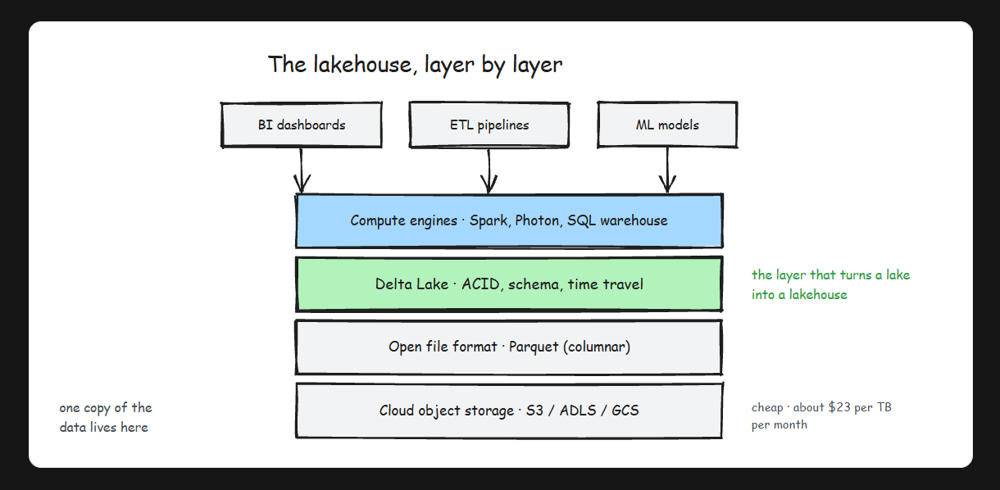

# Databricks Overview

- Databricks is a managed lakehouse platform, built by Spark's original creators, that runs on top of your own cloud account.
- Databricks does not store your data inside some proprietary Databricks database. Your data sits as files in your own cloud storage, and Databricks provides the compute, the catalog, and the workspace to process it.

## The problem: running Spark yourself was miserable

## Where it sits in the data engineering lifecycle

- When someone asks "what is Databricks?", give the one-liner first: a managed lakehouse platform from the creators of Apache Spark that runs on top of your cloud account. Then show depth with two follow-up points. One, it is more than hosted Spark: Delta Lake, Unity Catalog, SQL warehouses, and MLflow are the platform pieces. Two, the data stays in the customer's own cloud storage while Databricks manages the platform, which is the architecture question that usually comes next. Avoid calling it a database or "a cloud", both are instant credibility hits.
- Databricks is a managed lakehouse platform built by the original creators of Apache Spark. It exists because running Spark yourself meant carrying clusters, tuning, notebooks, and security on your own back. It bundles managed Spark clusters, notebooks, Delta Lake, SQL, jobs, and ML into one workspace, deploys on top of your own AWS, Azure, or GCP account (your data never leaves your storage), and serves data engineers, analysts, and data scientists on one shared copy of the data.

# Data LakeHouse Architecture

- Understand the lakehouse architecture that combines data lake flexibility with data warehouse reliability.

