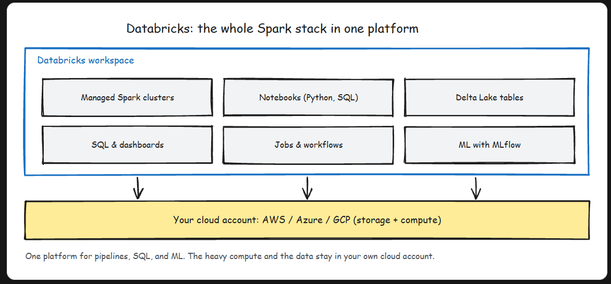

# Databricks Overview

- Databricks is a managed lakehouse platform, built by Spark's original creators, that runs on top of your own cloud account.
- Databricks does not store your data inside some proprietary Databricks database. Your data sits as files in your own cloud storage, and Databricks provides the compute, the catalog, and the workspace to process it.

## The problem: running Spark yourself was miserable
