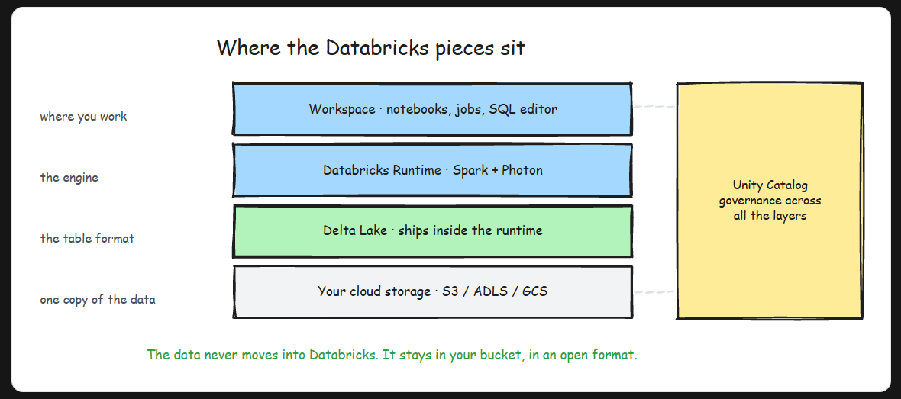

# Databricks Overview

- Databricks is a managed lakehouse platform, built by Spark's original creators, that runs on top of your own cloud account.
- Databricks does not store your data inside some proprietary Databricks database. Your data sits as files in your own cloud storage, and Databricks provides the compute, the catalog, and the workspace to process it.


## The problem: running Spark yourself was miserable
- It is because of three things: Scalability, Maintenance, Security


## Where it sits in the data engineering lifecycle


- When someone asks "what is Databricks?", give the one-liner first: a managed lakehouse platform from the creators of Apache Spark that runs on top of your cloud account. Then show depth with two follow-up points. One, it is more than hosted Spark: Delta Lake, Unity Catalog, SQL warehouses, and MLflow are the platform pieces. Two, the data stays in the customer's own cloud storage while Databricks manages the platform, which is the architecture question that usually comes next. Avoid calling it a database or "a cloud", both are instant credibility hits.
- Databricks is a managed lakehouse platform built by the original creators of Apache Spark. It exists because running Spark yourself meant carrying clusters, tuning, notebooks, and security on your own back. It bundles managed Spark clusters, notebooks, Delta Lake, SQL, jobs, and ML into one workspace, deploys on top of your own AWS, Azure, or GCP account (your data never leaves your storage), and serves data engineers, analysts, and data scientists on one shared copy of the data.

# Data LakeHouse Architecture

- Understand the lakehouse architecture that combines data lake flexibility with data warehouse reliability.


## What a lakehouse actually is:


- At the bottom sits cloud object storage: S3, ADLS, or GCS. This is where your one copy of the data lives, at lake prices. On top of that, the data is stored as Parquet, an open, columnar file format that any engine can read.
- The layer above is the one that changes everything: **Delta Lake**. Delta is not a database and not a server. It is a **transaction log**, a folder called **_delta_log** sitting right next to your Parquet files, recording every change as a numbered commit. That little log is what upgrades a pile of files into a real table:
    - ACID transactions: a write either fully commits or never happened. No more half-written folders.
    - Schema enforcement: a write with the wrong columns gets rejected instead of quietly poisoning the table.
    - Time travel: every commit is history you can query, so you can read the table as it was yesterday.
- And on top of Delta sit the compute engines (Spark clusters, the Photon engine, SQL warehouses) that serve every workload from the same tables. Delta is the format Databricks uses by default, but it is one of three open table formats that do this job. **Apache Iceberg** and **Apache Hudi** are the siblings, and they all share the same core trick: a transaction log over open files.
```py
df.write.format('delta')\
    .mode('append')\
    .saveAsTable('sales.orders')

# Behind that call, Databricks writes Parquet files to your bucket and adds a commit to the log. And because every commit is preserved, you get time travel for free:

-- The table exactly as it was before last night's load
SELECT COUNT(*) FROM sales.orders VERSION AS OF 41;

-- Or by timestamp
SELECT COUNT(*) FROM sales.orders TIMESTAMP AS OF '2026-07-01';

```
- Dumping Parquet files into S3 and calling it a lakehouse. Without a table format like Delta on top, there are no transactions, no schema checks, and no history. That is just a data lake wearing a nicer name, and it will swamp exactly the same way. The table format is the load-bearing part of the word "lakehouse".

## Where Databricks fits
- The lakehouse is an architecture, not a product. Databricks is the company that coined the term and built the most complete implementation of it, and its pieces map cleanly onto the layers you just saw.

- Workspace is where you work: notebooks in Python, SQL, Scala, or R, scheduled jobs for production pipelines, and a SQL editor with dashboards.
- Databricks Runtime is the engine: Apache Spark plus Photon, a native C++ execution engine that Databricks quotes at up to 12x faster than open-source Spark on SQL workloads.
- Delta Lake ships inside the runtime, so every table you create is a Delta table unless you go out of your way to avoid it.
- Unity Catalog sits across all of it, handling permissions, lineage, and governance for every table, notebook, and model.
- The detail people underrate: your data never moves into Databricks. The Parquet files and the Delta log live in your own cloud account, in your own bucket. Databricks brings the compute to the data, not the other way around.

- In an interview
    - When you get "what is a lakehouse?", do not recite a marketing line. Give the problem first: companies ran a lake for raw data and ML plus a warehouse for BI, with a copy pipeline between them, which meant double cost and stale copies. Then the fix: warehouse guarantees (ACID, schema, history) implemented directly on lake storage through an open table format, so one copy of the data serves SQL, ETL, and ML. Name Delta Lake, Iceberg, and Hudi as the formats that make it possible. And be precise with terms: the lakehouse is an architecture, Databricks is one implementation of it. Mixing those two up is the fastest way to sound like you learned this from an ad.

- The lakehouse collapses two systems into one. Instead of a data lake for ML plus a data warehouse for BI plus a sync pipeline between them, you keep one copy of the data as open Parquet files in cheap object storage, let Delta Lake's transaction log add ACID, schema enforcement, and time travel on top, and point every engine (SQL, Spark, ML) at the same files. One copy, no sync jobs, no stale dashboards, and no vendor holding your data hostage.

