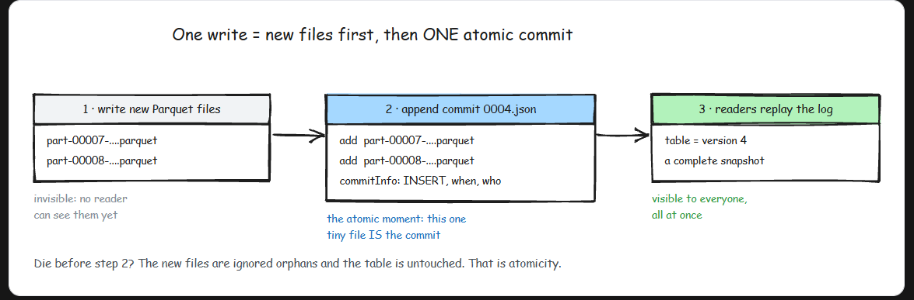
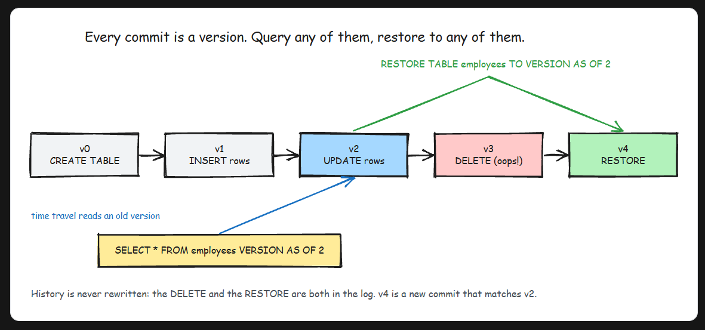

# Delta Lake
- Fundamental weakness of a plain data lake:  A folder of Parquet files has no concept of a transaction. Databases solved this decades ago with ACID guarantees, and data lakes threw those guarantees away in exchange for cheap storage and scale. Delta Lake is how you get them back, and the trick behind it is almost embarrassingly simple: **It is Parquet files plus a Transaction Log.**

- A Delta table is physically just a folder. Inside it you find regular Parquet data files, plus one special subfolder called `_delta_log`. That subfolder holds numbered JSON files, one per commit, and this log (often called the DeltaLog) is the single source of truth. The table is not "whatever files happen to be in the folder." The table is whatever the log says it is. Readers never trust the folder listing; they read the log and open only the files it names.

## What breaks with plain Parquet
- Parquet is a great file format. It is columnar, compressed, and fast to scan. But a bare folder of Parquet files gives you four nasty problems:
    - Partial writes: A job that dies halfway leaves half its files behind, and readers cannot tell finished data from garbage.
    - No updates or deletes: Parquet files are immutable. Want to fix one customer's record? You rewrite the dataset yourself and pray nothing reads it mid-rewrite.
    - Dirty reads: A query that runs while a write is in progress sees a moving target: some new files, some old ones.
    - No history: Once a file is overwritten or deleted, the old state is gone. There is no "what did this table look like yesterday."
## Anatomy of Commit
- So how does a write actually become "real"? When you modify a Delta table, the operation is broken into discrete actions, and a commit is just an ordered bundle of them:
    - 
- The order of events is what makes it atomic. First the new Parquet files are written (nobody can see them yet). Then one JSON file is appended to `_delta_log` listing the add and remove actions. That single file append is the commit. Before it exists, the write is invisible. The moment it exists, the write is fully visible to everyone.

- Basically, Delta cheats. Cloud object stores cannot atomically write 500 files, but they can atomically write one small JSON file. So Delta funnels all the "did this happen or not" logic through that one file. Every commit bumps the table version by one, which is also what powers time travel later.

# Advanced Delta Lake

- Delta Lake never edits files in place: every write adds new data files plus a new commit to the transaction log. Three operational tools fall straight out of that one design decision, and together they are the maintenance kit you will use on every serious Delta table. **Time travel** lets you query and restore old versions. **OPTIMIZE (with Z-ORDER)** keeps reads fast. **VACUUM** actually deletes old files. They are one system: time travel exists because old files stick around, OPTIMIZE adds files without removing any, and VACUUM is the only thing that ever truly deletes.

