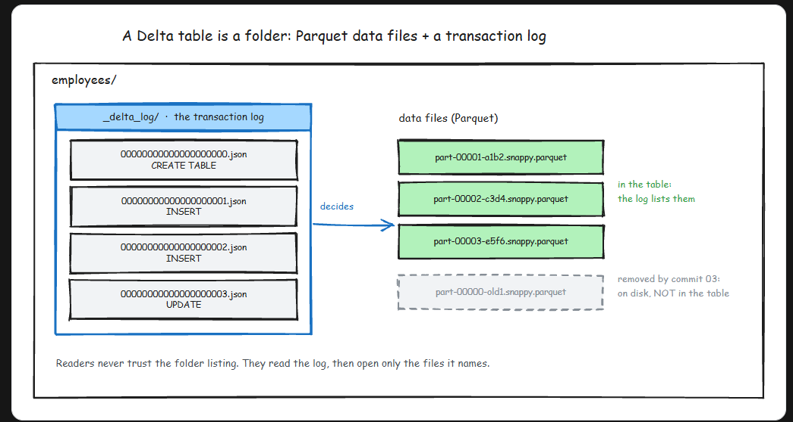
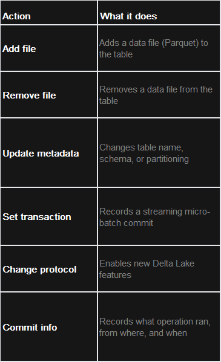
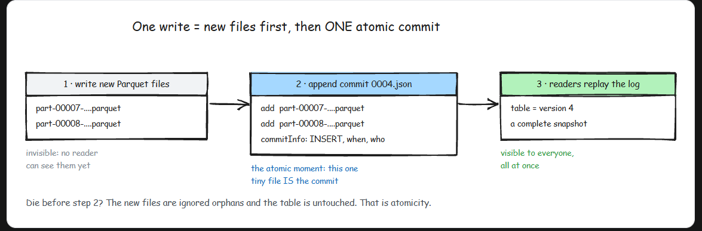
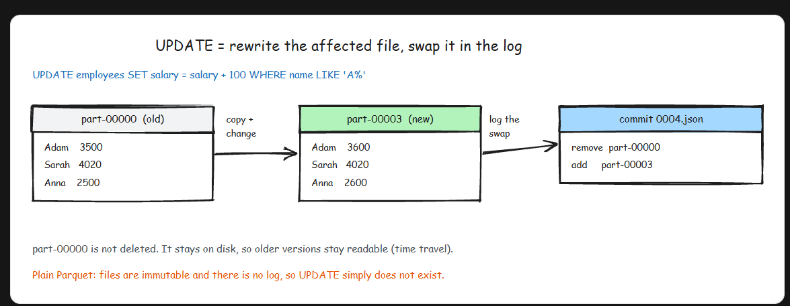
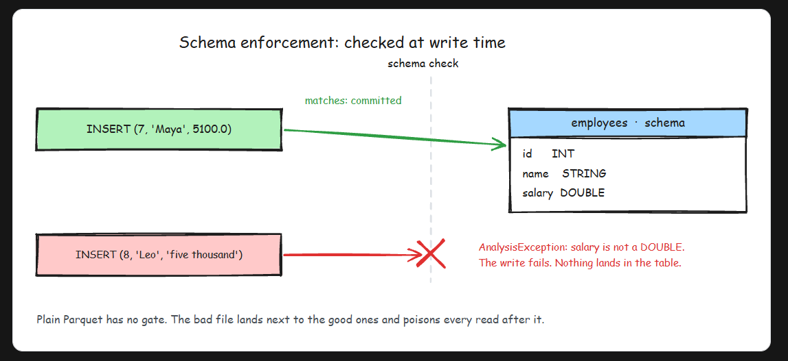
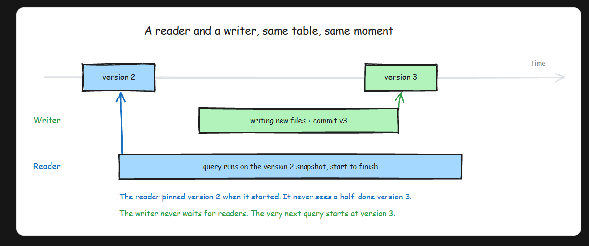
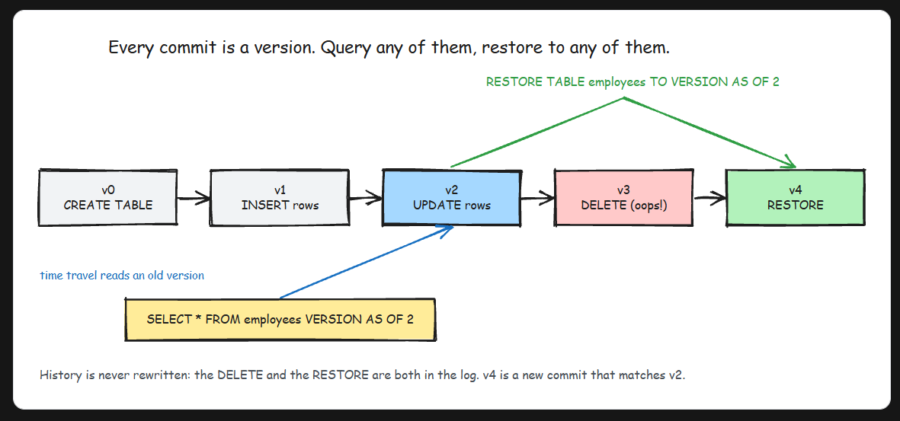
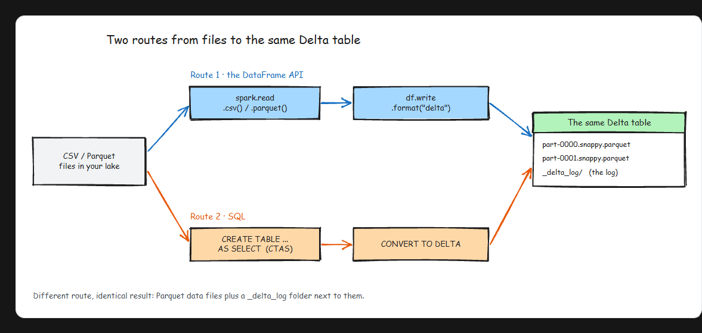
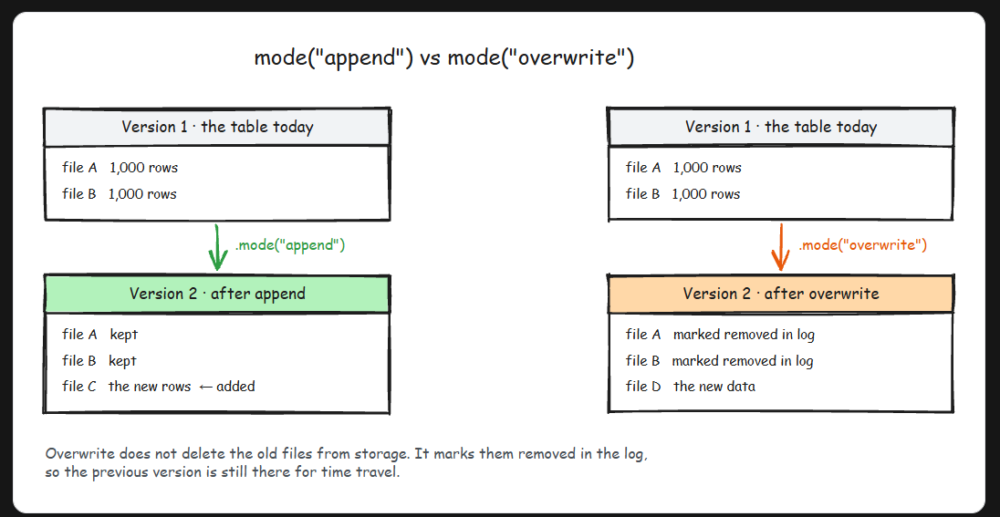
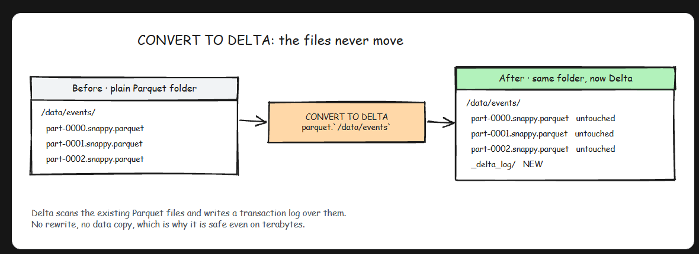

# Delta Lake
- Fundamental weakness of a plain data lake:  A folder of Parquet files has no concept of a transaction. Databases solved this decades ago with ACID guarantees, and data lakes threw those guarantees away in exchange for cheap storage and scale. Delta Lake is how you get them back, and the trick behind it is almost embarrassingly simple: **It is Parquet files plus a Transaction Log.**


- A Delta table is physically just a folder. Inside it you find regular Parquet data files, plus one special subfolder called `_delta_log`. That subfolder holds numbered JSON files, one per commit, and this log (often called the DeltaLog) is the single source of truth. The table is not "whatever files happen to be in the folder." The table is whatever the log says it is. Readers never trust the folder listing; they read the log and open only the files it names.

## What breaks with plain Parquet
- Parquet is a great file format. It is columnar, compressed, and fast to scan. But a bare folder of Parquet files gives you four nasty problems:
    - Partial writes: A job that dies halfway leaves half its files behind, and readers cannot tell finished data from garbage.
    - No updates or deletes: Parquet files are immutable. Want to fix one customer's record? You rewrite the dataset yourself and pray nothing reads it mid-rewrite.
    - Dirty reads: A query that runs while a write is in progress sees a moving target: some new files, some old ones.
    - No history: Once a file is overwritten or deleted, the old state is gone. There is no "what did this table look like yesterday."
## Anatomy of Commit
- So how does a write actually become "real"? When you modify a Delta table, the operation is broken into discrete actions, and a commit is just an ordered bundle of them:
    - 
- The order of events is what makes it atomic. First the new Parquet files are written (nobody can see them yet). Then one JSON file is appended to `_delta_log` listing the add and remove actions. That single file append is the commit. Before it exists, the write is invisible. The moment it exists, the write is fully visible to everyone.

- Basically, Delta cheats. Cloud object stores cannot atomically write 500 files, but they can atomically write one small JSON file. So Delta funnels all the "did this happen or not" logic through that one file. Every commit bumps the table version by one, which is also what powers time travel later.

## Creating and Updating Delta Table

- On Databricks, every table you create with SQL is a Delta table by default
```sql
-- Create a Delta table
CREATE TABLE employees
(id INT, name STRING, salary DOUBLE);

-- Insert data (each INSERT = one commit)
INSERT INTO employees VALUES
  (1, 'Adam', 3500.0),
  (2, 'Sarah', 4020.5);

INSERT INTO employees VALUES
  (3, 'John', 2999.3),
  (4, 'Thomas', 4000.3);

INSERT INTO employees VALUES (5, 'Anna', 2500.0);
INSERT INTO employees VALUES (6, 'Kim', 6200.3);

SELECT * FROM employees;

```
- Now inspect what actually got written to storage
```sql
-- Table details: format, location, size, number of files
DESCRIBE DETAIL employees

```

- Never touch the files by hand
    - The most common way people corrupt a Delta table is managing its folder like a normal folder: deleting "old" Parquet files by hand, or dropping extra Parquet files in to "add data." Both break the table, because the log still references files you removed, or knows nothing about files you added. All changes go through Delta (SQL or the DataFrame writer), and old files get cleaned up with VACUUM, which we cover in the next lesson. Notice the old file is not deleted. It stays on disk, which is exactly why time travel works: older versions of the table are still fully readable. Check the file system after the update and you will see the new files sitting next to the old ones, with the log deciding who is current. DELETE and MERGE work the same way

## Schema enforcement
- A data lake's other quiet killer is schema drift. Someone's upstream job starts writing salary as a string, the files land, and three weeks later every downstream query is either broken or silently casting garbage. Plain Parquet will accept anything you throw into the folder.
- Delta checks every write against the table's schema at write time. If the incoming data does not match, the write fails loudly and nothing lands:

- This flips the failure mode from "silent corruption you discover weeks later" to "loud error at the moment of the bad write," which is the failure mode you want. And when the schema genuinely needs to change (a new column, say), Delta supports controlled schema evolution: you opt in explicitly with mergeSchema instead of having drift happen to you.

## Many readers, one writer, zero drama
- The last gift the log gives you is snapshot isolation. When a query starts, it reads the log once and pins the latest version, say version 2. It then reads only the files that version 2 names, for the entire duration of the query, even if a writer commits version 3 halfway through.

- The reader never sees a half-finished write. The writer never waits for readers. The next query simply starts from version 3. And because every commit is numbered, you get a full audit trail for free:
```sql
-- See every operation ever performed on the table
DESCRIBE HISTORY employees

```
- That history (who ran what, when, and which version it produced) is the foundation for time travel, rollbacks, and reproducing yesterday's report, which is exactly where the next lesson goes.

- In an interview
    - The one-liner that shows you actually understand Delta Lake: "the table is the log, not the folder." Then explain atomicity through the write path: new Parquet files first, then one JSON commit appended to _delta_log, so a crashed job leaves orphan files but the table never changes. If asked how UPDATE works, say copy-on-write: rewrite the affected files, log a remove and an add, keep the old files for time travel. The common trap is calling Delta a file format. It is a storage layer on top of Parquet, and the transaction log is what adds ACID, schema enforcement, and versioning.

- Key Takeaway
    - Delta Lake is Parquet files plus a transaction log, and the log is the whole trick. The table is defined by _delta_log, not by the folder contents, so every write is atomic: it either commits to the log or it never happened. That one mechanism buys you ACID transactions, schema enforcement at write time, UPDATE, DELETE and MERGE via copy-on-write, snapshot isolation for concurrent readers and writers, and a versioned history of every change.


# Advanced Delta Lake

- Delta Lake never edits files in place: every write adds new data files plus a new commit to the transaction log. Three operational tools fall straight out of that one design decision, and together they are the maintenance kit you will use on every serious Delta table. **Time travel** lets you query and restore old versions. **OPTIMIZE (with Z-ORDER)** keeps reads fast. **VACUUM** actually deletes old files. They are one system: time travel exists because old files stick around, OPTIMIZE adds files without removing any, and VACUUM is the only thing that ever truly deletes.



# Delta Tables from Files

- Nobody starts a lakehouse from zero. By the time Delta Lake enters the picture, you already have folders full of CSV exports and Parquet files sitting in storage. So the practical question is not "how do I create a Delta table?" It is "how do I turn the data I already have into Delta, and how do I work with it every day after that?"
- That is this lesson. There are two routes into Delta, the DataFrame API and SQL, and both end at exactly the same thing on disk: Parquet files plus a transaction log. Once your data is in, we will run through the full toolkit, read, append, overwrite, update, delete, and merge, in both APIs, because in real pipelines you switch between them constantly.


## One word makes it Delta

```py
# Parquet: just files. No transaction log, no ACID.
df.write.format("parquet").save("/data")

# Delta: ACID transactions, versions, schema enforcement
df.write.format("delta").save("/data")

```
- That one word changes what lands on disk. Instead of a bare folder of Parquet files, you get the same Parquet files plus a _delta_log folder next to them. It gives you **atomic commits**, **versions** you can travel back to, and **schema checks** on every write.

## Route 1: the DataFrame API

- This is the route your production pipelines will use, because pipelines are code. Read from anywhere, transform, write Delta:
```py
data = spark.range(0, 5)
data.write.format("delta").save("/delta")

data.write.partitionBy("date").format("delta").save("/delta")


```
### Append or overwrite
- Here is something that surprises people: run that first write twice and the second one fails. Delta's default mode is `errorifexists`, and that is deliberate. It refuses to silently clobber data, so you have to say what you want:
```py
# Add new rows to the existing table
data.write.format("delta").mode("append").save("/delta")

# Replace the table contents entirely
data.write.format("delta").mode("overwrite").save("/delta")

```

- The interesting part is what overwrite actually does. It does not delete the old files. It writes the new files, then records in the log that the old ones are no longer part of the table. The overwrite is logical, not physical. That is exactly why time travel works: version 1 is still sitting there in storage, and the log knows how to reassemble it.

## Route 2: SQL, with CTAS and CONVERT TO DELTA

- If your data is already somewhere SQL can query, you can build a Delta table without writing a single line of Python.

### 1. CTAS
```sql
CREATE DATABASE IF NOT EXISTS credit_card;
USE credit_card;

CREATE OR REPLACE TEMP VIEW temp_credit_card AS
SELECT *
FROM parquet.`dbfs:/databricks-datasets/credit-card-fraud/data/part-00000-tid-898991165078798880-9c1caa7b-283d-47c4-9be1-aa61587b3675-0-c000.snappy.parquet`;

CREATE TABLE credit_card_managed
USING DELTA
AS SELECT * FROM temp_credit_card;

```
- CTAS reads the source and writes a fresh copy as Delta. That is perfect when the dataset is modest or you want to clean and reshape it on the way in. But if you have 2 TB of Parquet already sitting in a folder, copying all of it just to add a log is wasteful.

### 2. Convert To Delta
```sql
CONVERT TO DELTA parquet.`/data/events`;

-- if the folder is partitioned, tell Delta how:
CONVERT TO DELTA parquet.`/data/events` PARTITIONED BY (event_date DATE);

```
 
- CONVERT TO DELTA never moves your data. It scans the existing Parquet files, collects their metadata, and writes a `_delta_log` over them. The files stay byte for byte where they were. That is why converting a multi-terabyte folder takes minutes instead of the hours a full rewrite would cost. For most migrations, this is the command you want.