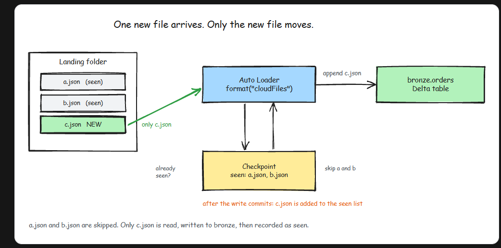

# AutoLoader
- Auto Loader is a Spark Structured Streaming source. Instead of reading with format("json"), you read with format("cloudFiles") and point it at a folder. From then on, Auto Loader:
    - discovers files as they land in that folder
    - processes only the files it has not seen before
    - records every processed file in a checkpoint, so nothing is read twice
    - guarantees exactly-once processing per file, even across crashes and restarts
- Do not let the word "streaming" scare you off. A stream here does not mean an always-on cluster burning money around the clock. You can run an Auto Loader stream like a scheduled batch job, and most teams do exactly that. We will see how in a second.
- 