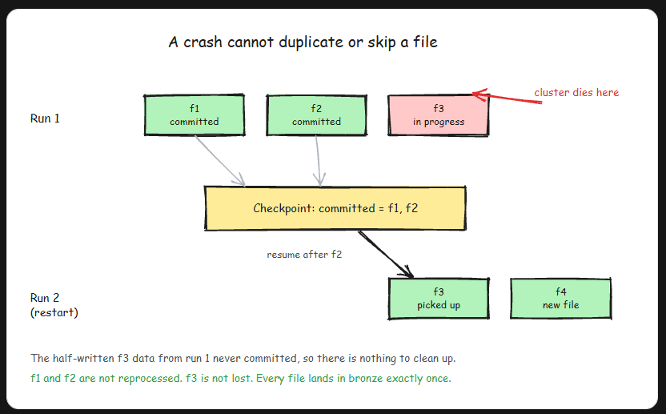
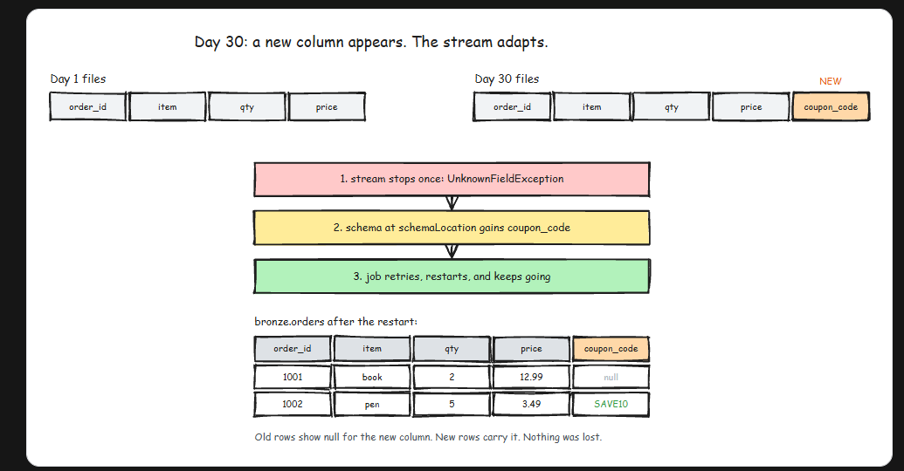
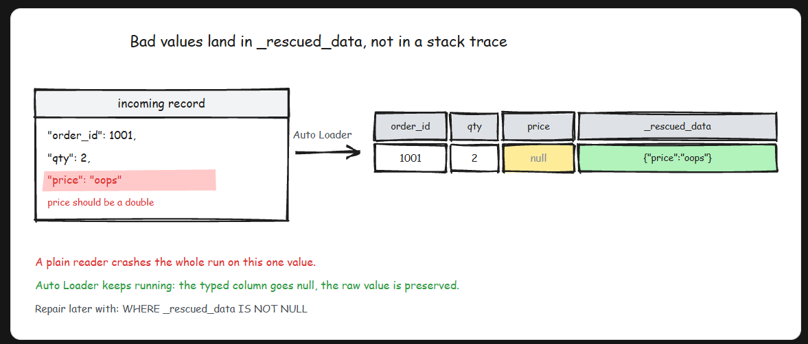

# AutoLoader
- Auto Loader is a Spark Structured Streaming source. Instead of reading with format("json"), you read with format("cloudFiles") and point it at a folder. From then on, Auto Loader:
    - discovers files as they land in that folder
    - processes only the files it has not seen before
    - records every processed file in a checkpoint, so nothing is read twice
    - guarantees exactly-once processing per file, even across crashes and restarts
- Do not let the word "streaming" scare you off. A stream here does not mean an always-on cluster burning money around the clock. You can run an Auto Loader stream like a scheduled batch job, and most teams do exactly that.
- 

## Example: Landing (raw files) folder -> Bronze Folder

```py
from pyspark.sql.functions import *

-- first we will create a data frame which has ability to capture each and every file

df = spark.readStream.format("cloudFiles")\
    .option("cloudFiles.format","csv")\
        .option("cloudFiles.schemaLocation","path for checkpoint folder")\
            .option("cloudFiles.schemaEvolutionMode","addNewColumns")\
                .load("path of raw file folder")

-- Now we will write our files in bronze layer

df.writeStream.format("delta")\
    .outputMode("append")\
        .trigger(availableNow = True)\
            .option("checkpointLocation","path for checkpoint folder")\
                .option("path","path for data folder")\
                    .start()

```
- `cloudFiles.format` is the format of the incoming files: json, csv, parquet, avro, and so on.
- `schemaLocation` is where Auto Loader stores the schema it infers from your files. Required for formats like JSON and CSV that do not carry their own schema.
- `checkpointLocation` is the stream's memory: which files have been processed, and where to resume after a restart. This is the piece that replaces your hand-rolled tracking.
- `.trigger(availableNow=True)` tells the stream to process everything new, then shut down. Schedule this in a Databricks job every hour and you get incremental batch ingestion. Remove it and the stream runs continuously, picking up files within seconds.
- Run this twice in a row and the second run processes zero files, because the checkpoint already knows about all of them. That is the whole trick.
- The checkpoint is the stream's memory, so treat it with respect. One checkpoint per stream per target table, and never delete it to "fix" an error. Deleting it makes the next run reprocess the entire folder into your table as duplicates.

## Exactly once, even when the job crashes
- The part that makes Auto Loader production-grade is what happens when things go wrong. Say a run processes files f1 and f2, commits them to the bronze table, and then the cluster dies halfway through f3. On restart, the stream reads its checkpoint, sees f1 and f2 are committed, and resumes at f3. Nothing is skipped, nothing lands twice.
- 
- This works because the checkpoint and the Delta transaction log commit together. Your hand-rolled control table could never quite promise this, because updating the table and writing the data were two separate steps that could fail independently. Here it is one atomic story.

## Schema inference and evolution
- Auto Loader samples your files, infers a schema, and stores it at schemaLocation. That handles day one. The interesting question is day 30, when the upstream team quietly adds a coupon_code field to their JSON and tells nobody. I promise you this will happen.
- With the default evolution mode, addNewColumns, the stream stops with an error the first time it meets the new column, updates the stored schema to include it, and on the next start the new column flows into bronze. Old rows just show null for it. In a Databricks job with retries enabled, this is a blip measured in seconds, not an outage.
- 
- If you need different behavior, there are other modes: rescue never fails and shoves new columns into the rescue column, and failOnNewColumns refuses to move until you update the schema yourself. Most of the time, stick with addNewColumns. It matches what you actually want in bronze: keep everything.

## The _rescued_data safety net
- New columns are one thing. Bad values are another. Suppose a file arrives where price is the string "oops" instead of a number. A plain reader either crashes the job or silently nulls the value, and both are bad. Auto Loader does something smarter: the typed column becomes null, and the original raw value is preserved in a _rescued_data column as JSON, along with the source file path. The job keeps running, nothing is lost, and you can inspect and repair the bad rows later with a simple filter on `_rescued_data IS NOT NULL`.
- 

## How Auto Loader discovers new files
- Two modes
- Directory listing is the default. Auto Loader lists the folder and compares against its checkpoint. Zero setup, no extra cloud services, and it is fine for the vast majority of folders.
- File notification flips the model: instead of Auto Loader asking "anything new?", the cloud tells it. Auto Loader subscribes to storage events (S3 events through a queue, and the equivalents on Azure and GCP), so a landing file pushes a notification instead of waiting to be found. This matters when folders get huge. Listing a folder with 10 million objects means thousands of list calls per run, which is slow and costs real API money every single time.

## Auto Loader vs COPY INTO vs plain spark.read
- `spark.read` is for one-off loads. You have a fixed set of files, you load them once, done. No tracking needed because there is no next time.
- `COPY INTO` is a SQL command that also skips already-loaded files. Good for occasional, manually triggered or lightly scheduled loads on the order of thousands of files, especially for SQL-first teams.
- Auto Loader is for folders where files keep landing. It scales to millions of files, handles schema evolution, and runs as either a scheduled batch or a continuous stream.

-----
- Reusing or deleting checkpoints
    - The two checkpoint mistakes I see most: pointing two different streams at the same checkpointLocation, which corrupts both streams' memory of what they have processed, and deleting a checkpoint to clear an error, which resets the stream's memory so the next run re-ingests every file in the folder as duplicates. One stream, one target, one checkpoint, and fix errors without touching it.
- In an interview
    - When ingestion from cloud storage comes up, name the actual problem first: new files keep arriving, and re-reading the whole folder does not scale. Then give the mechanism, not just the brand name: Auto Loader is a Structured Streaming source (format("cloudFiles")) that tracks processed files in a checkpoint for exactly-once ingestion, and trigger(availableNow=True) lets it run as a scheduled batch job. Strong candidates also mention schema evolution and _rescued_data, because that shows you have thought about what happens after day one. If asked Auto Loader vs COPY INTO, say it in one line: COPY INTO for occasional loads of thousands of files, Auto Loader for continuous landing zones and millions of files.
- Key Takeaway
    - Auto Loader is a Structured Streaming source (format("cloudFiles")) that ingests only the new files landing in a cloud folder, tracking what it has seen in a checkpoint for exactly-once processing. It infers schemas, evolves them when new columns appear, and rescues malformed values into _rescued_data instead of crashing. Run it with trigger(availableNow=True) as a scheduled batch, and treat it as the default way to feed bronze tables in a medallion pipeline.


