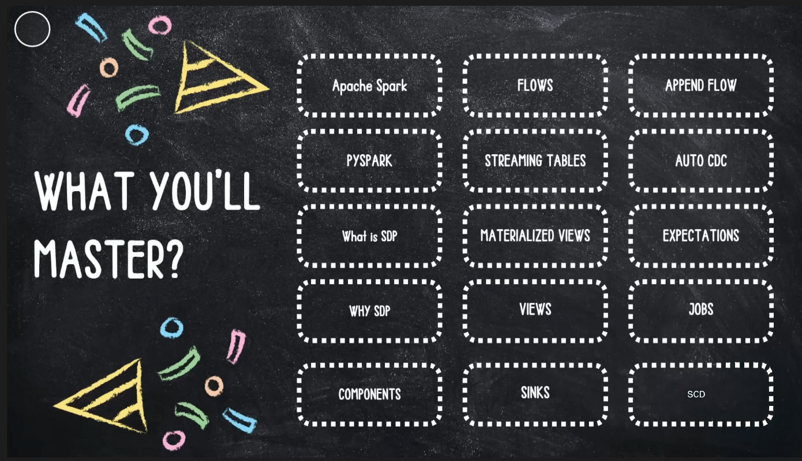

# Spark Declarative Pipeline

- When working with data in spark, we often wants to focus on WHAT we want to do with the data, rather than HOW spark executes it under the hood. This where Declarative Pipelines comes in.
- Unlike traditional imperative programming, where you give step by step instructions, declarative pipline let you define a series of transformations and actions on your data in a clean, readable way. Spark then figures out most efficient execution plan.
- One of the biggest adavantage of declarative pipline is that they remove lot of traditional overhead in spark jobs. usually when you write a spark code imperatively, you spend time manually creating partitins, coalescing data, caching tables, and tuning performance.
- Declarative pipelines handle these optimizations automatically. You dont need to worry about underline mechanics- Spark figures out most efficient way to process your data.
- You dont have to worry about execution details like task scheduling or memory optimization. Instead, you describe a flow of operations- like filtering, joining or aggregations and sparh handles the rest. This approach reduces bugs,improve performance, and makes your data pipelines more robust.
- Declarative pipeline also reduce the long, repetative code that often comes with data engineeering tasks. For example, implementing SCD Type 2 manually involves writing lots of step for detecting changes, updating records, and maintaining history.
- With Declarative pipelines, you can leverage tools like AutoCDC, which handle these operations automatically. This lets you focus on business logic rather than boilerplate code.

- Key Components:
    1. Flows: A flow is the foundational data processing concept in SDP which supports both streaming and batch semantics. A flow reds data from a source, applies user defined processing logic, and writes the result into target dataset.